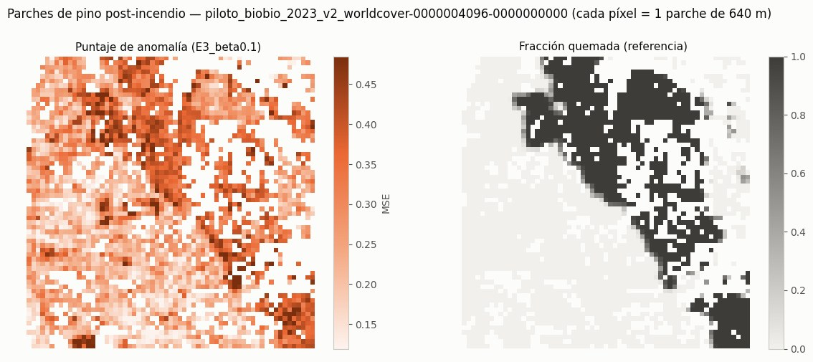

# Detección generativa de degradación de suelo en monocultivos de pino

Proyecto del curso **Generative Deep Learning** (Universidad de Concepción) — Mario Salgado Orellana.

Un **VAE convolucional** se entrena solo con parches de plantación sana vistos por Sentinel-2. Lo que el modelo no logra
reconstruir se usa como **puntaje de daño**, y se valida con los incendios de 2023 en la región del Biobío, Chile.

## Resultados (avance 1)

El modelo se evalúa con 564 parches sanos y 312 quemados de después del incendio, que no vio al entrenar. El error de reconstrucción separa bien unos de otros:

| Experimento | AUROC en test |
|---|---:|
| Baseline (β = 0,5) | 0,806 |
| β = 0,1 | 0,834 |
| β = 0,1 con 3 semillas | 0,832 ± 0,002 |

- Bajar β (menos peso a la KL) mejora la detección, y el resultado es estable entre semillas.
- El canal NBR, que mide quema, es clave: con la etiqueta de MODIS, quitarlo baja el AUROC de 0,814 a 0,615.
- En el mapa, el puntaje de daño se correlaciona con la fracción quemada de cada zona (Spearman = 0,54).



El detalle de los experimentos (E1 a E7) y los desafíos que quedaron abiertos está en [`entregas/avance1`](entregas/avance1/).

## Estructura

```
├── pipeline_vae_pino.ipynb   código actual: GEE → parches → VAE → experimentos → mapa
├── data/                     GeoTIFF de entrada (no se suben; ver data/README.md)
├── runs/                     salidas al correr el notebook
├── docs/                     propuesta del proyecto
└── entregas/                 lo entregado en cada avance: enunciado, presentación, resultados
```

El notebook se mantiene en su **última versión**. El código exacto de cada entrega queda guardado con un *tag* de git.

## Entregas

| Entrega | Contenido | Código de esa entrega |
|---|---|---|
| [Avance 1](entregas/avance1/) | Dataset, preprocesamiento, baseline (E1) y experimentos E2–E7 | tag [`avance1`](https://github.com/MarioCSalgado/Proyecto-Generative-Deep-Learning/tree/avance1) |

## Cómo correrlo

```bash
pip install -r requirements.txt
```

1. Copia los 6 GeoTIFF en `data/raw/` (ver [`data/README.md`](data/README.md)).
   Para solo probar el pipeline sin datos, pon `USE_SYNTHETIC = True`.
2. Abre `pipeline_vae_pino.ipynb` desde la raíz del repositorio y córrelo completo. Las rutas son relativas (`./data/raw`, `./runs`).
3. Las celdas 1a y 1b se conectan a Earth Engine; si no tienes cuenta, sáltalas.

Python 3.11 y PyTorch 2.5. En una NVIDIA RTX 3060 (6 GB) cada experimento tarda unos 2–3 minutos y el notebook completo unos 40.

## Documentos

- [`docs/Propuesta_proyecto.pdf`](docs/Propuesta_proyecto.pdf): propuesta del proyecto (objetivos y plan).
