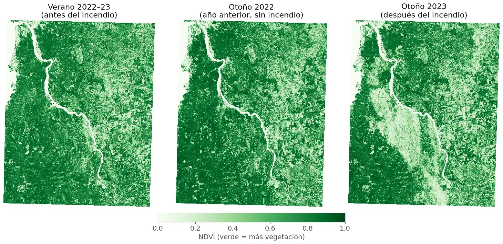
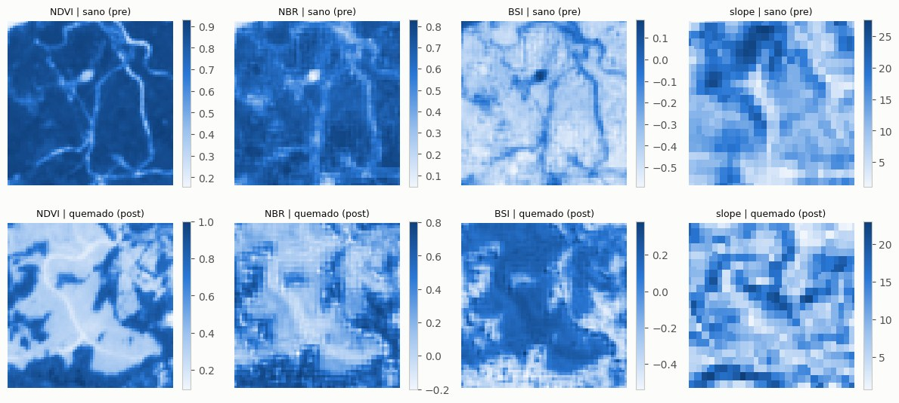
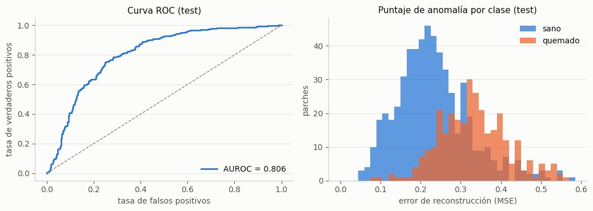
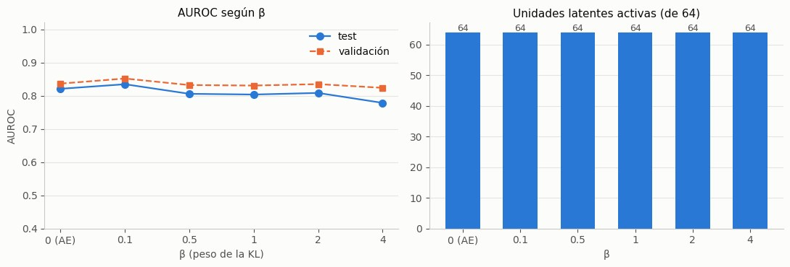
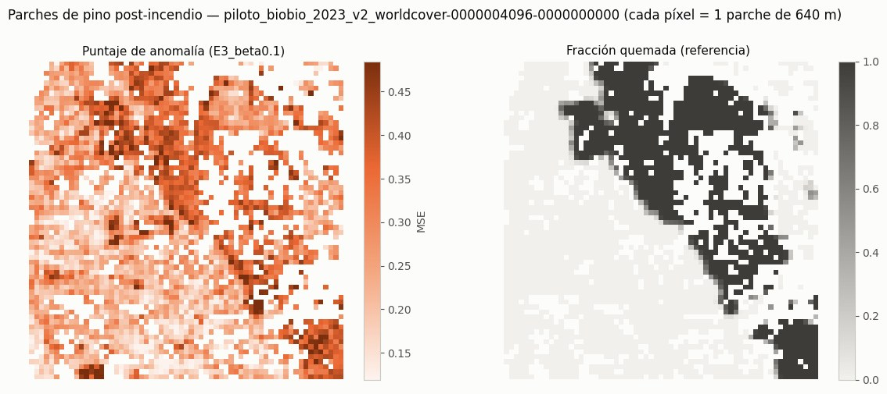

# Avance 1 — Dataset, preprocesamiento y baseline

Código de esta entrega: notebook v2 (corrida del 9 de octubre, con todas las salidas), guardado en el tag
[`avance1`](https://github.com/MarioCSalgado/Proyecto-Generative-Deep-Learning/blob/avance1/pipeline_vae_pino.ipynb). Presentación: [`presentacion/Avance1_presentacion.pdf`](presentacion/Avance1_presentacion.pdf).



## Qué pedía este avance

Enunciado: [`enunciado/Rubrica_Avance1.pdf`](enunciado/Rubrica_Avance1.pdf). La rúbrica evalúa tres criterios (4 puntos cada uno en el nivel más alto). Dónde se cubre cada uno:

| Criterio | Qué se pide para el máximo | Dónde está |
|---|---|---|
| Dataset y baseline | Dataset curado, preprocesado y probado; DataLoader y un primer entrenamiento funcional | Secciones 1–3 de este README; secciones 1–6 del notebook |
| Manejo de desafíos técnicos | Identificar problemas de entrenamiento (pérdida, estabilidad) y mostrar soluciones concretas ya probadas | Sección 5; experimentos E2–E7 |
| Calidad de presentación | Diapositivas visuales con gráficos de avance, buen manejo del tiempo y respuestas fluidas | [`presentacion/`](presentacion/) |

## 1. Datos

- **Fuente:** Sentinel-2 L2A (10 m) vía Google Earth Engine, zona de 71 × 89 km en el Biobío.
- **Limpieza:** máscara de nubes y sombras (SCL) y mediana de 41 a 51 escenas por fecha.
- **Canales:** NDVI (vegetación), NBR (quema: alto = sano), BSI (suelo desnudo) y pendiente.
- **Máscara:** árboles de ESA WorldCover 2021 (provisoria: mezcla pino y eucalipto).
- **Etiqueta** (solo para evaluar): quemado si dNBR ≥ 0,25. MODIS MCD64A1 como segunda etiqueta.

Detalle de los archivos y cómo descargarlos: [`data/README.md`](../../data/README.md).

## 2. Parches y división

- **Parche:** 64 × 64 px = 640 m, con al menos 80 % de árboles. 6.814 lugares, 29.656 muestras (lugar × fecha).
- **Sano:** ≤ 2 % quemado. **Quemado:** ≥ 50 %. Los intermedios no se evalúan.
- **División espacial por bloques** de 8 × 8 parches (~5 km), 70/15/15, para que parches vecinos no queden en grupos distintos.

| Lugares | Sanos | Quemados | Intermedios |
|---|---:|---:|---:|
| Train | 2.896 | 946 | 818 |
| Validación | 669 | 172 | 199 |
| Test | 564 | 312 | 238 |

El VAE se entrena con **10.188 parches sanos** de antes del incendio (paso de 32 px, con solape) y se evalúa con
**564 sanos y 312 quemados** de después.



## 3. Modelo

VAE convolucional: encoder de 4 capas (32 → 256 filtros), latente de 64 dimensiones y decoder espejo.
Pérdida = MSE + β · KL. AdamW (lr 1e-3), lote 64, 50 épocas. La época se elige por el error de reconstrucción en
validación sana (sin usar etiquetas). Puntaje de daño = error de reconstrucción.

## 4. Resultados (AUROC en test)

| Experimento | Qué cambia | AUROC |
|---|---|---:|
| **E1** baseline | β = 0,5 | **0,806** |
| E3 | β = 0 (autoencoder) / 0,1 / 1 / 2 / 4 | 0,821 / **0,834** / 0,804 / 0,808 / 0,778 |
| E2 | Warm-up de la KL (β = 1 / 4) | 0,821 / 0,790 |
| E4 | Weight decay 1e-4 y paciencia 10 | 0,801 |
| E5 | Entrenar con otoño previo (sesgo estacional 0,57 → 0,54) | 0,799 |
| E6 | Etiqueta MODIS / MODIS sin canal NBR | 0,814 / 0,615 |
| E7 | 3 semillas con β = 0,1 | 0,832 ± 0,002 |

Tabla completa: [`resultados/experimentos_avance1.csv`](resultados/experimentos_avance1.csv).
Las 64 dimensiones del latente quedan activas en todos los experimentos (sin colapso).
Error de train 0,209 vs. validación 0,205: sin sobreajuste.




## 5. Desafíos que quedaron abiertos

- El AUROC de validación oscila entre 0,83 y 0,97 de una época a otra aunque la pérdida converge (ver `03_E1_curvas`).
- La máscara de árboles mezcla pino y eucalipto.
- Sesgo estacional leve: sanos de verano vs. otoño se separan con AUROC 0,57.

Mapa del puntaje (Spearman con la fracción quemada: 0,54):



## Cómo reproducir esta entrega

```bash
git checkout avance1
```

Después sigue los pasos del [README principal](../../README.md#cómo-correrlo).
